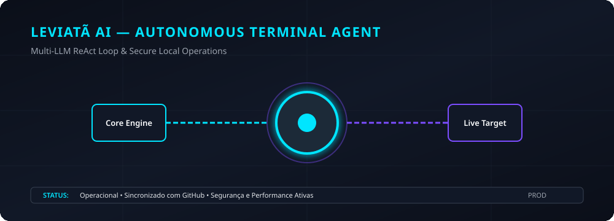

# Leviatã

<p align="center">
  
</p>

> **Agente local para Terminal Linux.** Organiza tarefas em linguagem natural, trabalha com modelos configurados pelo proprietário e mantém memória, auditoria e recursos sob controle local.

O Leviatã foi feito para Linux Mint e Termux. Ele ajuda a transformar uma ordem em um fluxo de trabalho verificável: entende o objetivo, seleciona capacidades pertinentes, registra ações e respeita a política local definida pelo proprietário.

## O que ele faz

| Área | Na prática |
|---|---|
| Conversa e orquestração | Abre uma interface local com `leviata`, interpreta linguagem natural e planeja tarefas ponta a ponta. |
| Desenvolvimento | Trabalha em um diretório autorizado, cria briefs de design e executa auditorias estáticas de código. |
| Conhecimento e memória | Consulta fontes, usa um único cofre Obsidian e mantém campanhas locais auditáveis por lotes. |
| Segurança defensiva | Faz modelagem de ameaças, ciclo seguro para sites locais e auditorias de projetos autorizados. |
| Recursos locais | Ajusta trabalhadores, lotes e contexto de acordo com a memória disponível, sem alterar RAM, swap ou processos externos. |

## Instalação

Revise o instalador antes de executá-lo e, depois, instale com:

```bash
curl -fsSL https://raw.githubusercontent.com/LEVIATAD21/leviata/master/install.sh -o install-leviata.sh
less install-leviata.sh
bash install-leviata.sh
source ~/.bashrc
```

O instalador cria um ambiente Python isolado em `~/.leviata-ai`, instala as dependências e disponibiliza o comando `leviata` no terminal. Configurações e dados de instalações anteriores em `~/.kawa-ai` são migrados sem apagar o histórico.

## Uso em segundos

```bash
leviata
leviata "revise este projeto Python"
leviata --autonomous "crie um plano para um site de portfólio"
leviata --memory-budget
```

Sem argumentos, `leviata` abre a interface conversacional local. O comando antigo `kawa` continua disponível como compatibilidade para instalações anteriores.

## Modelo e privacidade

O projeto pode usar Ollama com modelos locais ou provedores configurados pelo proprietário. A configuração fica em `~/.leviata-ai/config.json`; credenciais oficiais são solicitadas por prompt oculto e não devem ser adicionadas ao repositório.

O Leviatã separa consultas de ações que modificam arquivos, serviços ou contas. Os modos `observe`, `ask`, `workspace` e `proactive` organizam essa execução. Ações externas, irreversíveis ou sensíveis continuam dependendo de confirmação.

## Documentação

| Se você quer entender | Leia |
|---|---|
| Diretrizes e modos de operação | [`DIRETRIZES.md`](DIRETRIZES.md) |
| Ciclo seguro para sites locais | [`docs/SECURE_SITE_CYCLE.md`](docs/SECURE_SITE_CYCLE.md) |
| Memória e orçamento de recursos | [`docs/MEMORY_GOVERNOR.md`](docs/MEMORY_GOVERNOR.md) |
| Conexões persistentes e remoção explícita | [`docs/CONNECTIONS.md`](docs/CONNECTIONS.md) |
| Conhecimento e campanhas auditáveis | [`docs/KNOWLEDGE_TEST_MATRIX.md`](docs/KNOWLEDGE_TEST_MATRIX.md) |
| Referências de segurança de IA | [`docs/AI_SECURITY_SKILLS_ASSESSMENT.md`](docs/AI_SECURITY_SKILLS_ASSESSMENT.md) |
| Design, UX e acessibilidade | [`docs/DESIGN_REFERENCE_ASSESSMENT.md`](docs/DESIGN_REFERENCE_ASSESSMENT.md) |

## Escopo

O Leviatã foi projetado para autonomia local, desenvolvimento, aprendizado e segurança defensiva em ambientes autorizados. Ele não publica projetos, não abre portas públicas e não transforma métodos de jailbreak ou ataques destrutivos em capacidades operacionais.

---

Desenvolvido por **Kawã Silva dos Santos**. Projeto privado, mantido com foco em autonomia local, privacidade e evolução técnica responsável.
