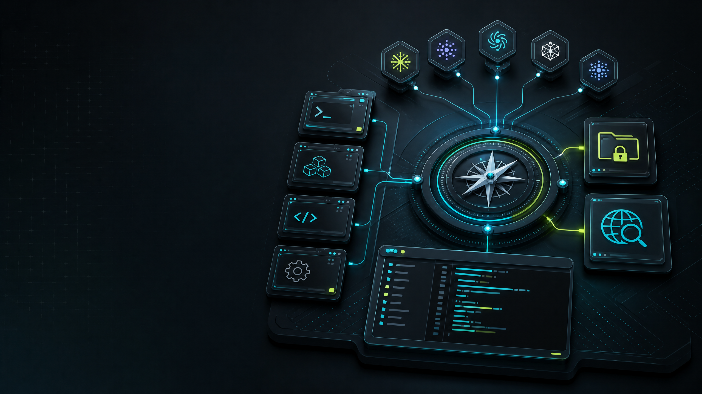

# KAWA-AI 🤖


<p align="center">
  
</p>

> Agente de IA Autônomo para Terminal Linux — Desenvolvido por Kawã Silva

Um assistente local para terminal Linux Mint, capaz de ler e criar arquivos, pesquisar fontes públicas, ajudar com código e executar ferramentas configuradas pelo proprietário. Suporta provedores por API e modelos locais via Ollama.

---

## ✨ Funcionalidades

- **Multi-LLM**: Troque o "cérebro" da IA quando quiser — OpenAI, Anthropic, Google Gemini, Ollama local ou API compatível configurada pelo proprietário
- **Execução de terminal com política local**: registra e confirma ações conforme o modo escolhido
- **Pesquisa web configurável**: usa SearXNG local quando disponível, com fallback público
- **Leitura e escrita de arquivos**: o modo `workspace` limita edições ao caminho definido
- **Loop de ferramentas validado**: planeja, valida as chamadas antes de executá-las e mantém contexto curto
- **Registro de auditoria**: salva ações em `~/.kawa-ai/logs/actions.jsonl`, com segredos redigidos
- **Perfis leves para CPU**: configuração inicial voltada a `qwen2.5:1.5b`
- **Interface bonita**: Terminal colorido e intuitivo

---

## 🚀 Instalação Rápida

```bash
curl -fsSL https://raw.githubusercontent.com/LEVIATAD21/manus-clone-ai/main/install.sh | bash
```

Depois, reinicie o terminal e use:
```bash
kawa
```

---

## ⚙️ Configuração Manual

Crie o arquivo `~/.kawa-ai/config.json`:

### Perfil local recomendado (Ollama)
```json
{
  "provider": "ollama",
  "model": "qwen2.5:1.5b",
  "base_url": "http://localhost:11434",
  "policy_mode": "ask",
  "workspace": "~/Projetos"
}
```

### OpenAI (GPT-4o)
```json
{
  "provider": "openai",
  "api_key": "sk-...",
  "model": "gpt-4o"
}
```

### Anthropic (Claude)
```json
{
  "provider": "anthropic",
  "api_key": "sk-ant-...",
  "model": "claude-3-5-sonnet-20241022"
}
```

### Google Gemini
```json
{
  "provider": "google",
  "api_key": "AIza...",
  "model": "gemini-2.0-flash"
}
```

### Ollama (Local — GRÁTIS)
```bash
# Primeiro instale o Ollama:
curl -fsSL https://ollama.ai/install.sh | sh
ollama pull llama3
```
```json
{
  "provider": "ollama",
  "model": "llama3"
}
```

### API Customizada (qualquer API compatível com OpenAI)
```json
{
  "provider": "custom",
  "api_key": "SUA_CHAVE",
  "base_url": "https://api.sua-ia.com/v1",
  "model": "nome-do-modelo"
}
```

---

## 💬 Como Usar

```bash
# Chat interativo local
kawa --interactive

# Tarefa direta
kawa "crie um script Python que lista todos os arquivos .mp3 na pasta Downloads"

# Permitir edições somente dentro de uma pasta específica
kawa --policy workspace --workspace ~/Projetos "Revise este projeto"

# Pesquisa que também cria uma nota Markdown no cofre local
kawa --knowledge "como funciona RAG local" --knowledge-save

# Roteia perguntas factuais para o cérebro de conhecimento e tarefas operacionais para o agente
kawa --auto-route "como funciona RAG local?"

# Na primeira execução, procura um cofre Obsidian e inicializa o único diário vazio
kawa --init-obsidian

# Quando houver vários cofres, escolha exatamente um; nunca é criado outro automaticamente
kawa --obsidian-vault "~/Documents/Meu Cofre" --init-obsidian

# Disponibiliza um Chromium local com perfil isolado para o agente
kawa --browser --policy ask "Abra https://example.com e leia a página"

# Usando um provedor específico
kawa --provider anthropic --model claude-3-5-sonnet-20241022 "sua tarefa"

# Usando Ollama local
kawa --provider ollama --model llama3
```

---

## 🛠️ Ferramentas Disponíveis

| Ferramenta | Descrição |
|---|---|
| `shell` | Executa qualquer comando no terminal Linux |
| `read_file` | Lê o conteúdo de qualquer arquivo |
| `write_file` | Cria ou edita arquivos |
| `web_search` | Busca informações na web (DuckDuckGo) |
| `web_fetch` | Acessa uma URL e retorna o conteúdo |

Os modos de política são `observe` (somente consulta), `ask` (padrão; confirma escrita e comandos) e `workspace` (permite edições no diretório definido e confirma ações de maior impacto).

### Cérebro de conhecimento

`--knowledge` ativa um módulo de consulta separado do assistente principal. Ele pergunta o que é, como funciona, quais são os limites e como confirmar o assunto; em seguida, entrega uma síntese baseada na pesquisa. Com `--knowledge-save`, o relatório é registrado como Markdown em `~/.kawa-ai/knowledge/` (ou na pasta definida por `--knowledge-vault`), sem mudar a identidade ou as permissões do KAWA-AI.

Com `--auto-route`, perguntas explicativas são encaminhadas ao cérebro de conhecimento e salvas no cofre; solicitações operacionais continuam no agente principal e passam pela política local. O roteador é determinístico, não carrega outro modelo e pode ser desativado a qualquer momento.

### Cofre Obsidian persistente

Na primeira execução, o KAWA-AI procura diretórios `.obsidian` em toda a árvore local a partir de `/`, sem ler o conteúdo de notas. Diretórios dinâmicos, caches e dependências pesadas são excluídos. Se localizar somente um, salva o caminho em `~/.kawa-ai/config.json` e cria o arquivo vazio e único `KAWA-AI/Reasoning Diary.md`. A partir daí, a memória é sempre acrescentada no mesmo diário e cópias de recuperação permanecem no mesmo cofre. Caso existam vários cofres, o programa pede o caminho explicitamente em vez de escolher ou criar outro.

Para restringir uma nova procura a uma unidade ou caminho específico, use `--scan-root /caminho`. `--index-vault` mostra somente metadados de arquivos Markdown dentro do cofre escolhido.

### Navegador local controlado

O parâmetro `--browser` habilita um Chromium local com perfil isolado em `~/.kawa-ai/browser-profile`; ele não usa automaticamente os cookies ou sessões do navegador principal. O KAWA-AI procura primeiro `google-chrome`, `chromium` ou `chromium-browser` já instalados no Linux Mint, evitando o download do Playwright quando possível. Se o navegador estiver em outro caminho, use `--browser-executable /caminho/do/executavel` ou a variável `KAWA_BROWSER_EXECUTABLE`.

Se não houver navegador instalado, execute `PLAYWRIGHT_DOWNLOAD_CONNECTION_TIMEOUT=120000 python3 -m playwright install chromium` para aumentar o tempo de conexão do download. Abertura e leitura de páginas são separadas de cliques e preenchimento: no modo padrão `ask`, qualquer clique ou texto digitado exige confirmação e seus dados são redigidos do registro de auditoria. Não habilite o modo sem janela em fluxos que precisem de login manual ou revisão visual.

---

## 🔧 Instalação Manual (sem curl)

```bash
git clone https://github.com/LEVIATAD21/manus-clone-ai.git
cd manus-clone-ai
pip3 install -r requirements.txt
python3 main.py
```

---

## 📁 Estrutura do Projeto

```
manus-clone-ai/
├── main.py              # Ponto de entrada principal (CLI)
├── install.sh           # Script de instalação via curl
├── requirements.txt     # Dependências Python
├── agent/
│   ├── __init__.py
│   └── core.py          # Núcleo do agente (loop ReAct)
├── providers/
│   └── __init__.py      # Provedores de LLM (OpenAI, Anthropic, etc.)
├── tools/
│   └── __init__.py      # Ferramentas (shell, web, arquivos)
└── config/
    └── config.example.json  # Exemplo de configuração
```

---

## 🔒 Privacidade

Este repositório é **privado**. Apenas você tem acesso. Suas chaves de API ficam salvas localmente em `~/.kawa-ai/config.json` e **nunca** são enviadas para o repositório (arquivo ignorado pelo `.gitignore`).

---

*Desenvolvido por Kawã Silva — github.com/leviatad21*
