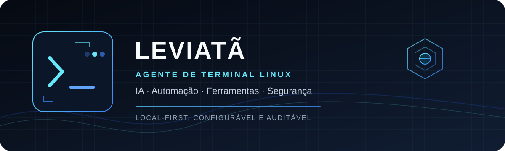

# Leviatã

> **Agente de IA para Terminal Linux, automação local e fluxos de desenvolvimento e segurança.**

O **Leviatã** é um assistente de terminal em Python que organiza tarefas por meio de um agente e de módulos especializados. O repositório reúne ferramentas para orquestração, referências técnicas, memória/RAG, navegador, voz, qualidade de código, criação de sites e práticas de segurança.

A configuração inicial prioriza o **Ollama local** (\`qwen2.5:1.5b\`) e o modo de política \`ask\`. Outros provedores e integrações existem no código; quando habilitados, podem enviar prompts ou conteúdo aos respectivos serviços externos. A privacidade depende do provedor e das ferramentas efetivamente configuradas.

## Módulos do projeto

- **Agente e orquestração:** roteamento de tarefas e coordenação de agentes.
- **Modelos e provedores:** configuração de provedor/modelo, com suporte ao Ollama e conectores opcionais.
- **Memória e conhecimento:** RAG local, catálogo de referências, integração opcional com Obsidian e outros armazenamentos.
- **Desenvolvimento e qualidade:** ferramentas de design, revisão e ciclo de melhoria de sites.
- **Segurança da informação:** referências de segurança web, simulações adversariais e ferramentas de pentest ético para ambientes autorizados.
- **Ferramentas de interação:** navegador, voz e gerenciamento local de conexões.

Os módulos disponíveis não significam que todas as integrações estejam configuradas ou que cada tarefa possa ser executada sem dependências adicionais.

## Requisitos

- Python 3.10 ou superior (recomendado: uma versão ainda suportada pelo ecossistema das dependências).
- \`pip\` e \`venv\`.
- Ollama instalado e em execução para o modo local padrão.
- Espaço em disco e memória compatíveis com o modelo escolhido.
- Navegador e dependências adicionais apenas para recursos específicos.

## Instalação

Na raiz do repositório:

\`\`\`bash
python3 -m venv .venv
source .venv/bin/activate
python -m pip install --upgrade pip
pip install -r requirements.txt
\`\`\`

Instale e inicie o Ollama separadamente e baixe o modelo padrão, caso ainda não esteja disponível:

\`\`\`bash
ollama pull qwen2.5:1.5b
ollama list
\`\`\`

Confira as opções disponíveis antes de iniciar uma tarefa:

\`\`\`bash
python3 main.py --help
\`\`\`

Para iniciar o modo interativo, execute \`python3 main.py\`. A configuração é mantida localmente em \`~/.leviata-ai/config.json\`; o programa também contém lógica para migrar uma configuração anterior de \`~/.kawa-ai/config.json\`.

## Configuração e privacidade

- O padrão de configuração usa o provedor \`ollama\`, o endereço local \`http://localhost:11434\` e a política \`ask\`.
- Revise \`~/.leviata-ai/config.json\` antes de alterar provedor, modelo, workspace ou modo de política.
- Provedores como OpenAI, Anthropic ou Google podem processar dados fora da máquina. Não use esses modos com informação confidencial sem avaliar as condições do serviço.
- Tokens e perfis de conexões devem ser tratados como segredos. Não os cole no código, nos issues, em logs públicos ou em commits.
- As ferramentas de navegador, shell e arquivos podem interagir com o ambiente configurado. Comece com um workspace de teste, revise as permissões e mantenha cópias de segurança.
- O modo de política e as validações do projeto são camadas de controle, não uma sandbox de segurança nem uma garantia de ausência de erros.

## Uso responsável de segurança ofensiva

Use as ferramentas de pentest e simulação somente em sistemas próprios, laboratórios ou alvos para os quais exista autorização explícita. Defina o escopo e as regras de engajamento antes de executar testes; não coloque credenciais reais nem dados de terceiros em laboratórios de demonstração.

## Diagnóstico

Se o modo local não responder, verifique:

\`\`\`bash
ollama list
curl -s http://localhost:11434/api/tags
python3 main.py --help
\`\`\`

Confirme também que o modelo configurado existe e que as dependências opcionais necessárias ao recurso escolhido estão instaladas.

## Autor

**Kawã Silva dos Santos** · [GitHub](https://github.com/LEVIATAD21)

> Projeto em evolução. A documentação descreve a arquitetura observada no repositório e não garante que todos os módulos opcionais estejam configurados ou prontos para produção.
